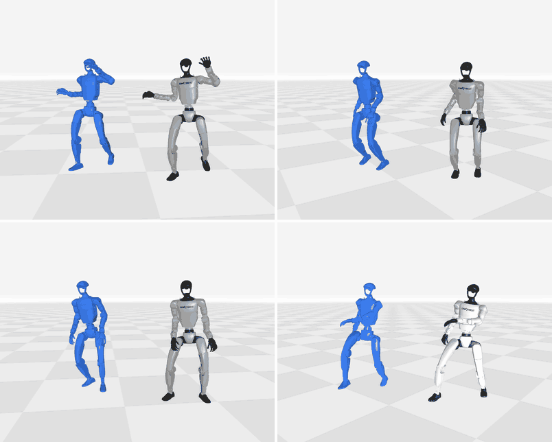

# SuperMimic Gym

**English** | [한국어](README_ko.md)

<p align="center"></p>
<p align="center"><sub>One policy, four LAFAN1 clips. White: policy in MuJoCo. Blue: reference motion.</sub></p>

Whole-body motion tracking for the Unitree G1 with [SuperMimic](https://arxiv.org/abs/2610.28480): a differentiable world model fit on replay, and a goal-conditioned policy trained by back-propagating the tracking reward through imagined rollouts. The structure follows [legged-gym-mujoco](https://github.com/JihoonPark20/legged-gym-mujoco). Physics runs on multithreaded CPU MuJoCo; the world model, policy and critic train on CUDA, MPS or CPU, so the same code runs on Linux and macOS.

## Install

```bash
python -m pip install -e .                      # Python 3.10–3.13; install a CUDA build of PyTorch first on NVIDIA machines
python -m legged_gym.scripts.prepare_motions    # 40 LAFAN1 clips, SHA256-checked -> data/motions/lafan1
```

## Train

```bash
python -m legged_gym.scripts.train                                   # 1024 environments, 21000 steps
python -m legged_gym.scripts.train --resume --max_iterations 10000   # continue from the latest checkpoint
```

Logs and checkpoints (`model_*.pt`, ~216 MB, every 500 steps) go to `logs/g1_mimic/`. One iteration is one vectorised environment step with 0.4 learner updates. The learner device is chosen automatically (CUDA, then MPS, then CPU) or with `--rl_device`. Settings live in [g1_mimic_config.py](legged_gym/envs/g1_mimic/g1_mimic_config.py).

## Play and evaluate

```bash
mjpython -m legged_gym.scripts.play --checkpoint_path checkpoints/g1_mimic_lafan1.pt --motion jumps1_subject1   # macOS viewer
python -m legged_gym.scripts.play --checkpoint_path checkpoints/g1_mimic_lafan1.pt --evaluate                   # 40-clip benchmark
python -m legged_gym.scripts.export_policy logs/g1_mimic/<run>/model_21000.pt checkpoints/my_policy.pt          # policy only
python -m pytest tests
```

On Linux the viewer runs with `python`. `--evaluate` plays every clip once from its first frame without noise or randomization and writes a JSON report beside the checkpoint. `--resume` instead of `--checkpoint_path` picks the latest training checkpoint.

## Results

`checkpoints/g1_mimic_lafan1.pt` was trained with the default settings for 21000 iterations (8384 updates) in 3 h 27 min on an Apple M1 Max. On the 40-clip evaluation:

| Mean normalized return | Step-weighted | Completed clips |
|---:|---:|---:|
| 0.753 | 0.777 | 28 / 40 |

Seven of the twelve early terminations are fall-and-get-up clips.

## Physics on the CPU, learning on the accelerator

Measured on an Apple M1 Max with 1024 environments and batch 512; one iteration is one control step plus 0.4 updates.

| Setup | Physics | Update | Per iteration |
|---|---:|---:|---:|
| **This repository: MuJoCo CPU, 10 threads + MPS** | 38 ms | 1.22 s | **0.53 s** |
| MuJoCo Warp on the CPU device + MPS (mjlab on macOS) | 1101 ms | 1.22 s | 1.59 s |
| MuJoCo CPU + CPU learner | 38 ms | 7.94 s | 3.21 s |

Without CUDA, MuJoCo Warp runs on its CPU device and used a single core here; native `mujoco.batch` was 29× faster with 10 threads on the same model and solver settings. The learner is dominated by wide MLPs and 32-step backpropagation, where MPS with `torch.compile` was 6.5× faster than the CPU. On NVIDIA GPUs, MuJoCo Warp would simulate on the GPU instead; this repository keeps physics on the CPU so one code path serves every platform.

## Layout

```
legged_gym/envs/g1_mimic/   task configuration and environment
legged_gym/supermimic/      world model, imagination, policy/critic, replay, runner, benchmark
legged_gym/scripts/         train, play, prepare_motions, export_policy
legged_gym/sim/             MuJoCo model construction and batched simulation
resources/                  G1 model (Unitree), LAFAN1 manifest
```

## Licenses

Code: [BSD-3](LICENSE). The SuperMimic implementation is ported from [supermimic-m5](https://github.com/WXyuany/supermimic-m5) ([MIT](licenses/supermimic_m5_LICENSE)); robot model and configuration sources are in [licenses](licenses). LAFAN1 is CC BY-NC-ND 4.0: it is downloaded rather than redistributed, and policies trained on it are for non-commercial research.
