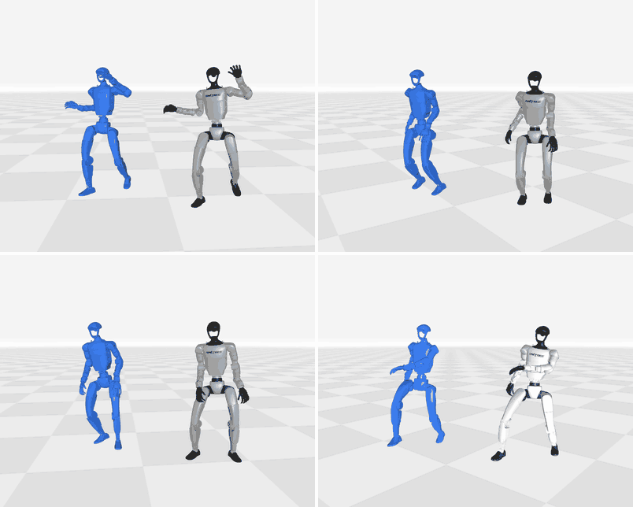

# SuperMimic Gym

[English](README.md) | **한국어**

<p align="center"></p>
<p align="center"><sub>하나의 정책, LAFAN1 클립 4개. 흰색: MuJoCo의 정책. 파란색: 참조 동작.</sub></p>

[SuperMimic](https://arxiv.org/abs/2610.28480)으로 Unitree G1의 전신 모션 트래킹을 학습합니다. 리플레이로 미분 가능한 월드 모델을 학습하고, 상상 롤아웃을 통해 트래킹 보상을 역전파하여 목표 조건부 정책을 학습합니다. 구조는 [legged-gym-mujoco](https://github.com/JihoonPark20/legged-gym-mujoco)를 따릅니다. 물리는 멀티스레드 CPU MuJoCo에서, 월드 모델·정책·크리틱은 CUDA, MPS 또는 CPU에서 학습하므로 같은 코드가 Linux와 macOS에서 동작합니다.

## 설치

```bash
python -m pip install -e .                      # Python 3.10–3.13; NVIDIA 환경은 CUDA용 PyTorch를 먼저 설치
python -m legged_gym.scripts.prepare_motions    # LAFAN1 40개 클립(SHA256 검증) -> data/motions/lafan1
```

## 학습

```bash
python -m legged_gym.scripts.train                                   # 환경 1024개, 21000스텝
python -m legged_gym.scripts.train --resume --max_iterations 10000   # 최신 체크포인트부터 이어서 학습
```

로그와 체크포인트(`model_*.pt`, 약 216 MB, 500스텝마다)는 `logs/g1_mimic/`에 저장됩니다. 1 iteration은 벡터화된 환경 1스텝과 학습기 업데이트 0.4회입니다. 학습 장치는 자동 선택(CUDA, MPS, CPU 순)되며 `--rl_device`로 지정할 수 있습니다. 설정은 [g1_mimic_config.py](legged_gym/envs/g1_mimic/g1_mimic_config.py)에 있습니다.

### SuperMimic과 SuperMimic-ODE

두 태스크는 기존 G1 환경, 월드 모델, 크리틱, 리플레이와 러너를 공유합니다. 정책의 행동 생성 방식만 다르며 환경 설정, 네트워크 크기와 학습 예산은 같습니다.

```bash
python -m legged_gym.scripts.train --task supermimic --seed 0
python -m legged_gym.scripts.train --task supermimic-ode --seed 0
python -m legged_gym.scripts.train --task supermimic-ode --resume --max_iterations 10000
```

| 태스크 | 정책 | 로그 |
|---|---|---|
| `g1_mimic` (기존 기본값 유지) | 행동 직접 출력, MLP | `logs/g1_mimic/` |
| `supermimic` | 행동 직접 출력, MLP | `logs/supermimic/` |
| `supermimic-ode` | 이전 행동 + 범위가 제한된 행동 변화량 | `logs/supermimic-ode/` |

ODE 정책은 [ODE Policy의 RL 구현](https://github.com/NTUMARS/ODE-POLICY/tree/9c505796ad0ecb811a12ab2c1ba3b8975af52a01/rl/supermimic_ode)을 따릅니다. `a_t = clip_amax(a_prev + clip_dmax(decoder(z, history)))`로 행동을 계산하며, 관측 이력의 마지막 **노이즈를 더하기 전 행동**을 사용합니다. 환경별 리셋 시 0에서 시작하고, 50 Hz 제어 스텝마다 Euler 적분을 한 번 수행합니다. 디코더 출력 자체가 스텝당 변화량이므로 `dt`를 추가로 곱하거나 별도 solver를 설치하지 않습니다. 상상 롤아웃에서는 이전 행동을 통한 역전파 경로가 유지됩니다.

`G1MimicCfgSuperMimicODE.policy`에 `actor="ode"`, `ode_dmax=1.62`, 원본의 관절별 `ode_amax` 29개가 설정되어 있습니다. 정규화된 행동 단위의 경험적 제한이며 물리적 관절 한계는 아닙니다. 현재 G1과 관절 순서 및 행동 스케일을 대조했습니다. 두 태스크 모두 이 저장소의 기본값인 환경 1024개·상상 배치 512를 사용합니다. 원본의 환경 4096개 GPU 실험과 다르므로 같은 seed와 예산으로 비교해야 합니다. 아래 기존 결과는 MLP 체크포인트의 결과이며 ODE 학습 결과가 아닙니다.

TensorBoard에는 `policy/imag_action_rate`, `policy/dJda_first`, `policy/dJda_last`, `policy/dJda_log_first_over_last`가 추가됩니다. ODE의 `policy/ode_step_bound_fraction`, `policy/ode_action_bound_fraction`은 최종 변화량·행동이 설정한 한계에 도달한 비율이며, 디코더 원출력의 클리핑 비율은 아닙니다.

## 재생과 평가

```bash
mjpython -m legged_gym.scripts.play --checkpoint_path checkpoints/g1_mimic_lafan1.pt --motion jumps1_subject1   # macOS 뷰어
python -m legged_gym.scripts.play --checkpoint_path checkpoints/g1_mimic_lafan1.pt --evaluate                   # 40개 클립 벤치마크
python -m legged_gym.scripts.export_policy logs/g1_mimic/<run>/model_21000.pt checkpoints/my_policy.pt          # 정책만 저장
python -m pytest tests
```

Linux에서는 뷰어를 `python`으로 실행합니다. `--evaluate`는 모든 클립을 첫 프레임부터 노이즈·무작위화 없이 한 번씩 재생하고 결과 JSON을 체크포인트 옆에 저장합니다. `--checkpoint_path` 대신 `--resume`을 쓰면 최신 학습 체크포인트를 사용합니다.

ODE 정책의 학습 재개·재생·평가에는 같은 태스크를 지정합니다.

```bash
python -m legged_gym.scripts.play --task supermimic-ode --resume --evaluate
python -m legged_gym.scripts.export_policy logs/supermimic-ode/<run>/model_21000.pt checkpoints/my_ode_policy.pt
mjpython -m legged_gym.scripts.play --task supermimic-ode --checkpoint_path checkpoints/my_ode_policy.pt
```

체크포인트와 정책 내보내기에 정책 종류와 ODE 제한값이 보존됩니다. MLP와 ODE는 가중치 크기가 같더라도 서로 잘못 불러오면 오류가 발생합니다. 정책 종류 필드가 없는 과거 체크포인트는 MLP로 처리하며 `g1_mimic` 또는 `supermimic`으로 사용할 수 있습니다. 정책만 저장한 파일은 재생·평가용이고, 학습 재개에는 전체 체크포인트가 필요합니다. 환경이나 네트워크 설정을 변경했다면 `run_config.json`을 체크포인트와 함께 보관하세요.

평가 JSON에는 태스크, 정책 설정, 완주율, 전체 길이 기준 리턴과 평활도가 포함됩니다. 전체 길이 기준 리턴은 보상 합을 `최대 스텝 보상 × max(참조 프레임 수, 실행 스텝 수)`로 나눕니다. 넘어져 실행하지 못한 구간은 0점으로 처리하고 종료 처리 스텝도 고려합니다. 기존 정규화 리턴 정의는 유지됩니다. 평활도는 행동 차분 제곱 평균(`action_rate`), 행동 2차 차분 제곱 평균(`action_acc`), 관절 가속도 절댓값 평균(rad/s²), jerk 절댓값 평균(rad/s³)입니다. 리셋 직전 마지막 속도까지 사용하되 에피소드 경계를 넘는 차분은 제외하고, 전체 평균은 유효 차분 수로 가중합니다.

## 결과

`checkpoints/g1_mimic_lafan1.pt`는 기본 설정으로 21000 iteration(업데이트 8384회)을 Apple M1 Max에서 3시간 27분 동안 학습했습니다. 40개 클립 평가 결과:

| 평균 정규화 리턴 | 스텝 가중 | 완주한 클립 |
|---:|---:|---:|
| 0.753 | 0.777 | 28 / 40 |

조기 종료 12건 중 7건은 넘어졌다 일어나는 클립입니다.

## 물리는 CPU, 학습은 가속기

Apple M1 Max, 환경 1024개, 배치 512 실측입니다. 1 iteration은 제어 1스텝과 업데이트 0.4회입니다.

| 구성 | 물리 | 업데이트 | iteration당 |
|---|---:|---:|---:|
| **이 저장소: MuJoCo CPU 10스레드 + MPS** | 38 ms | 1.22 s | **0.53 s** |
| MuJoCo Warp CPU 디바이스 + MPS (macOS의 mjlab) | 1101 ms | 1.22 s | 1.59 s |
| MuJoCo CPU + CPU 학습기 | 38 ms | 7.94 s | 3.21 s |

CUDA가 없으면 MuJoCo Warp는 CPU 디바이스에서 실행되며 측정 시 단일 코어만 사용했습니다. 같은 모델과 솔버 설정에서 네이티브 `mujoco.batch` 10스레드가 29배 빨랐습니다. 학습기는 넓은 MLP와 32스텝 역전파가 대부분이라 MPS(`torch.compile`)가 CPU보다 6.5배 빨랐습니다. NVIDIA GPU에서는 MuJoCo Warp가 GPU에서 시뮬레이션할 수 있지만, 이 저장소는 모든 플랫폼에서 하나의 코드 경로를 쓰도록 물리를 CPU에 둡니다.

## 구성

```
legged_gym/envs/g1_mimic/   태스크 설정과 환경
legged_gym/supermimic/      월드 모델, 상상 학습, 정책·크리틱, 리플레이, 러너, 벤치마크
legged_gym/scripts/         train, play, prepare_motions, export_policy
legged_gym/sim/             MuJoCo 모델 구성과 배치 시뮬레이션
resources/                  G1 모델(Unitree), LAFAN1 매니페스트
```

## 라이선스

코드: [BSD-3](LICENSE). SuperMimic 구현은 [supermimic-m5](https://github.com/WXyuany/supermimic-m5)([MIT](licenses/supermimic_m5_LICENSE))에서 이식했고, 로봇 모델과 설정 출처는 [licenses](licenses)에 있습니다. LAFAN1은 CC BY-NC-ND 4.0으로, 재배포하지 않고 다운로드하며 이 데이터로 학습한 정책은 비상업 연구용입니다.

ODE 통합은 NTUMARS/ODE-POLICY(Apache-2.0)와 SuperMimic-Reproduced(MIT) 대상 패치를 참고해 이식했습니다. 고정 커밋, 변경 내용 및 라이선스는 [ode_policy_NOTICE](licenses/ode_policy_NOTICE)에 기록했습니다. 사용 시 [ODE Policy](https://arxiv.org/abs/2611.01729)와 SuperMimic 논문을 함께 인용해주세요.
